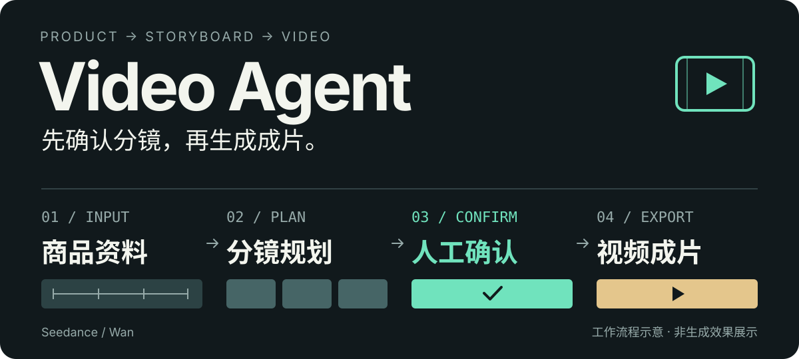

# Video Agent

<p align="center">
  
</p>

**从商品资料到视频成片，让 AI 规划分镜，让你确认再生成。**

面向电商视频制作与业务系统接入的 Python Agent，支持火山方舟 **Seedance**、阿里云百炼 **通义万相**，提供 HTTP API 与桌面测试工具。

[快速开始](#快速开始) · [接入真实模型](#接入真实模型) · [API 使用与部署](docs/api/usage.md)

## 从一张商品图开始

上传商品图片，填写名称、卖点和视频需求，得到可修改的分镜方案；确认后生成各个镜头，再导出 MP4。

> 例如：上传保温杯图片，填写「轻便、便携」，选择 5 秒、9:16，并描述「展示商品与使用场景」。先检查分镜，再确认生成；成片后可以只重做选中的镜头。

1. **提供资料** — 商品图片、卖点、首帧与创作需求。
2. **规划并确认** — 信息不足时补充资料，修改分镜后确认当前方案。
3. **生成并导出** — 准备首帧，逐镜头生成与下载，按顺序合并成片。
4. **按需调整** — 失败重试、整条重生成，或复用其他片段只重做指定镜头。

## 核心能力

| 能力 | 使用方式 |
| --- | --- |
| 可确认的分镜规划 | 使用 OpenAI Chat 兼容接口规划；支持结构化修改与自然语言修改 |
| 两种视频供应商 | 通过配置选择 Seedance 或万相，按供应商能力生成镜头 |
| 局部重生成 | 选择已有成片中的镜头重做，复用未选中的基础片段 |
| 异步任务与恢复 | API 提交任务，Worker 执行；保存进度并恢复过期租约任务 |
| 业务接入 | Bearer Token 认证、幂等请求、任务查询与成片分段下载 |
| 本地流程验证 | fake 模式不调用付费供应商，用真实 FFmpeg 导出占位视频 |

## 快速开始

以下以 **Windows / PowerShell** 为例。需要 Python **3.11+**、MySQL **5.7+**（InnoDB、utf8mb4），以及 PATH 中可运行的 **FFmpeg / ffprobe**。桌面工具还需要 Python 的 Tkinter。

### 1. 安装依赖

在仓库根目录运行：

```powershell
python -m venv .venv
.venv/Scripts/python.exe -m pip install -e '.[dev]'
ffmpeg -version
ffprobe -version
```

### 2. 准备数据库与配置

创建独立的 MySQL 数据库与应用账号，再按 [部署说明](docs/api/usage.md#安装与初始化) 配置访问权限。数据库示例：

```sql
CREATE DATABASE video_agent CHARACTER SET utf8mb4 COLLATE utf8mb4_bin;
```

首次配置时复制模板；已有 `.env` 时直接修改：

```powershell
if (-not (Test-Path .env)) { Copy-Item .env.example .env }
```

填写 [.env.example](.env.example) 中对应的配置项：

| 配置 | 用途 |
| --- | --- |
| `VIDEO_AGENT_DB_*` | MySQL 地址、端口、库名、账号和密码 |
| `VIDEO_AGENT_BUSINESS_TOKEN` | 业务 API Token |
| `VIDEO_AGENT_ADMIN_TOKEN` | 管理 API Token，须与业务 Token 不同 |
| `VIDEO_AGENT_SECRET_KEY` | Fernet 主密钥，用于加密模型凭据，需持久保存 |
| `VIDEO_AGENT_HOME` | 媒体目录，默认 `.video-agent` |

两个 Token 必须非空；主密钥须为有效的 Fernet 密钥。生成方式见 [配置说明](docs/api/usage.md#手动启动)。各进程使用同一数据库、媒体目录与主密钥，重启时沿用原主密钥。

然后初始化数据库表结构：

```powershell
.\start-webapi.bat -Mode migrate
```

新数据库默认使用 **fake 模式**，可以先验证完整流程，再配置真实模型。

### 3. 选择运行入口

**桌面体验**：适合手动填写需求、修改方案与查看成片，启动后自带 Worker。

```powershell
.\start-desktop.bat
```

添加一张商品图片并选为首帧，填写名称和卖点，选择 5 秒、9:16。点击「创建任务」，待方案生成后点击「确认当前方案」，完成后点击「打开成片」。fake 模式产出的是商品图占位视频，用于验证流程。

**HTTP API**：适合接入自己的前端或业务系统，在两个终端分别启动 API 和 Worker。

```powershell
# 终端 1：HTTP 服务
.\start-webapi.bat
```

```powershell
# 终端 2：异步任务执行
.\start-webapi.bat -Mode worker
```

当前只运行一个 Worker；桌面工具已内置 Worker，使用桌面入口时不要再启动独立 Worker。

启动后打开 [Swagger UI](http://127.0.0.1:8000/docs)，在 Authorize 中填写 Token 值。完整的「上传 → 规划 → 确认 → 下载」请求示例见 [API 调用指南](docs/api/usage.md#上传规划生成与下载)。

## 接入真实模型

通过桌面「设置」或管理 API 创建模型配置，再将规划与视频角色绑定到对应配置，最后切换为 `real` 模式。

| 角色 | 适配器 | 配置要点 |
| --- | --- | --- |
| 分镜规划 | `openai_chat` | OpenAI Chat 兼容地址、API Key、模型名 |
| 视频生成 | `seedance` | 火山方舟地址、API Key、模型名 |
| 视频生成 | `wan` | 百炼地址、API Key、模型名、单段最长秒数 |

视频角色在 Seedance 与万相中选择一个。可用时长、比例、首尾帧等能力取决于所选供应商与模型；配置与绑定步骤见 [模型配置说明](docs/api/usage.md#模型配置与公共设置)。

## 接入时需要了解

- **画面文字由视频模型生成**，导出阶段不再烧录字幕；文字准确性和排版需实际检查。
- **音频来自视频模型**，当前不执行独立配音或后期配乐。模型未提供音轨时，也可导出静音视频。
- **导出校验媒体格式，不评估画面质量**；当前不生成视觉质检报告，成品标记为 `not_assessed`。
- **调用方共享任务空间**，外部用户与请求 ID 用于业务筛选，不构成多租户权限隔离。
- **MySQL 是当前运行数据库**，MariaDB 不作为支持后端；旧 SQLite / JSON 数据需显式迁移。

## 项目结构

```text
video_agent/   规划、生成、导出、状态管理与供应商适配
api_app/       FastAPI 服务与本地托管的接口文档
desktop_app/   Tkinter 桌面测试工具
migrations/    Alembic 数据库迁移
tests/         核心流程、API 与数据库测试
docs/api/      部署、调用、配置与恢复说明
```

继续阅读 [API 使用与部署](docs/api/usage.md)，了解请求幂等、失败重试、健康检查、旧数据迁移和隔离测试。
