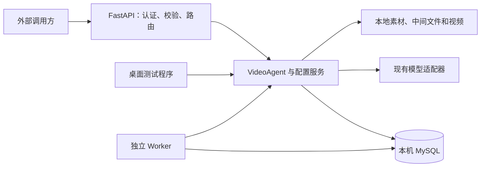

# Video Agent API 与 MySQL 改造设计草案

日期：2026-10-14（Asia/Shanghai）  
状态：用户已于 2026-10-14 明确授权多 agent 实施及创建所需数据库表；保留不创建 Git 节点、不正式迁移现有用户数据的边界。  
关联计划：`docs/superpowers/plans/2026-10-14-api-mysql.md`

## 1. 已确认需求与建议默认值

用户已确认：把现有 Agent 做成供外部系统调用的 API；模型配置等管理功能也通过 API 开放；模型配置和任务数据都存本机 MySQL；提供在线接口文档；先完成开发计划，不直接改代码。

连接账号使用用户提供的本机 MySQL root 账号。密码不写进这两份文档、源码、示例或日志；实施时通过环境变量注入。

以下是供审阅的建议，不是用户已确认的事实：

- MySQL 8.0+；主机 `127.0.0.1`、端口 `3306`、数据库名 `video_agent`。实施时先只读确认本机实际版本、端口及目标库，不能覆盖已有同名业务库。
- FastAPI + Uvicorn 提供 HTTP；SQLAlchemy Core + PyMySQL 提供数据库访问；Alembic 提供版本化迁移。
- HTTP 进程与 Worker 进程分离；首版一台机器、一个 Worker、多请求客户端，素材与视频继续保存在本地目录。
- 首版提供业务 Token 和管理 Token，使用 Bearer 认证；业务调用方共享一套任务空间。`external_user_id` 是业务标识，不是权限凭证。多租户隔离需要另行设计。
- HTTP 默认监听 `127.0.0.1:8000`；局域网或公网发布由后续部署决定，本次不发布服务。
- 桌面测试程序继续可用，配置和任务也接入同一 MySQL；仍直接调用核心包，不在本次重做桌面界面。

## 2. 现状与必须处理的差异

| 现有文件 | 现状 | 本次设计影响 |
| --- | --- | --- |
| `video_agent/service.py` | `VideoAgent` 已具备素材登记、任务创建、方案修改/确认、重试、重生成和查询 | API 复用业务方法，不建立第二套状态机 |
| `video_agent/models.py` | Pydantic 请求和视图模型 | 复用业务字段，补充 HTTP 专用输入、分页和配置视图 |
| `video_agent/db.py` | 单 SQLite 连接、线程锁、`BEGIN IMMEDIATE` | 改为连接池和 MySQL 事务；进程内锁不能替代数据库并发控制 |
| `video_agent/state.py`、`idempotency.py` | sqlite3 类型、问号参数和直接 SQL | 改为明确的命名参数和字典行结果，保留状态与幂等语义 |
| `video_agent/config.py` | `load_config(home)` / `save_settings(home, patch)` 读写 JSON | 验证逻辑保留，运行时配置改读写数据库 |
| `video_agent/worker.py` | 单步推进、租约续期、过期恢复 | 提供独立入口，领取和续期使用数据库原子操作 |
| `video_agent/pipeline.py` | 已有 copied_config；仍直接调用可变的 `agent.video` 等实例 | 真正按工作快照构造适配器，不能只记录快照却使用新实例 |
| `video_agent/factory.py` | openai_chat、seedance、wan、openai_vision 等注册 | 暴露能力元数据并校验角色与适配器兼容性 |
| `seedance_video.py`、`wan_video.py` | 供应商幂等键/任务号/下载尺寸存在本地 JSON 缓存 | 新增数据库任务记录存储；外部接口协议保持现有行为 |
| `desktop_app/*` | 直接读取配置、启动线程 Worker | 统一数据库配置入口，避免两份配置及重复启动 Worker |

工作区已有多处修改及未跟踪文件。本次不覆盖这些内容，也不提交、创建分支或 worktree。现有 2026-10-09 设计中“不提供 HTTP、使用 SQLite/JSON”的边界由本草案替代，其视频业务规则继续有效。

## 3. 方案选择

推荐：HTTP 层复用 `VideoAgent`，数据库整体迁入 MySQL，单独启动 Worker。复用最多，能够明确控制任务恢复、配置版本和长任务执行。

备选：HTTP 进程内启动 Worker。启动简单，但进程重载、多个 Uvicorn 进程会重复启动后台工人，且请求服务和生成任务互相影响，不作为交付架构。

备选：Celery + Redis + MySQL。适合跨机器并行，但首版没有这个要求；本项目已有工作表和租约机制，不增加第二套队列。

模型调用和 FFmpeg 都在数据库事务之外执行。HTTP 返回资源或任务状态后，客户端轮询；客户端断开连接不取消已落库任务。保留“上传素材 → 创建任务 → 获取方案 → 修改/确认 → 查询生成进度 → 下载成片”。

## 4. API 合约

统一前缀 `/api/v1`；成功响应直接使用明确的资源模型，列表为 `{items, limit, offset, total}`。分页默认 limit=20，最大 100，offset 最小 0。列表按 `updated_at DESC, task_id DESC` 排序，在数据库内分页。

| 方法 | 路径（均在 /api/v1 下） | 行为 |
| --- | --- | --- |
| POST | `/assets` | multipart 上传图片/音频，返回 asset_id 等元数据；不接受服务器绝对路径 |
| GET | `/assets/{asset_id}/content` | 按资产 ID 读取素材 |
| POST | `/tasks` | 创建任务，201 返回 TaskView；不会等待方案或视频完成 |
| GET | `/tasks` | 分页，支持 status、external_user_id、external_request_id 精确筛选 |
| GET | `/tasks/{task_id}` | 查询需求、问题、方案头和进度 |
| PATCH | `/tasks/{task_id}/inputs` | 补充资料；200，若实际入队则 202 |
| GET | `/tasks/{task_id}/plans/{plan_version}` | 读取具体方案版本 |
| POST | `/tasks/{task_id}/plan-revisions` | 结构化或自然语言修改；200 或入队后 202 |
| POST | `/tasks/{task_id}/discard-revision` | 放弃未确认修改，200 |
| POST | `/tasks/{task_id}/confirm` | body 为 plan_version；确认并入队，202 |
| POST | `/tasks/{task_id}/retry-planning` | 重试规划，202 |
| POST | `/tasks/{task_id}/regenerations` | 整条或选镜头重生成，202 |
| GET | `/generations/{generation_id}` | 查询执行阶段和失败原因 |
| POST | `/generations/{generation_id}/retry` | 重试失败执行，202 |
| GET | `/tasks/{task_id}/artifacts` | 查询成片版本 |
| GET | `/artifacts/{artifact_id}/content` | 视频下载，支持框架标准 Range 行为；不返回服务器路径 |
| GET | `/capabilities` | 比例、时长档、上传限制和脱敏后的适配器能力 |
| GET | `/admin/adapter-types` | 管理员读取适配器角色、参数、必填项与能力 |
| GET/POST | `/admin/model-profiles` | 分页查询/新建模型配置 |
| GET/PATCH/DELETE | `/admin/model-profiles/{profile_id}` | 详情、更新、软删除；绑定中的配置不能删除 |
| GET/PATCH | `/admin/adapter-bindings` | planner/video/voice/music/visual 当前绑定；整组事务校验与更新 |
| GET/PATCH | `/admin/settings` | fake/real、时长档、默认时长、现有上传/码率/分辨率/租约参数 |

另外提供 `/health/live` 和 `/health/ready`。live 只反映进程存活；ready 检查数据库连接、迁移版本、FFmpeg/ffprobe、必要密钥和最近 30 秒 Worker 心跳，不调用真实供应商。检查失败返回 503 和脱敏诊断。

业务和管理 Token 都能调用业务 API，只有管理 Token 能访问 `/admin/*`。Token 从环境变量读取，以恒定时间比较校验；两个 Token 必须非空且不同，否则启动失败。缺失/错误返回 401，业务 Token 访问管理 API 返回 403。不增加账号注册和登录页面。

会产生业务状态变更的任务接口支持 `Idempotency-Key`，约束继续为 1～128 个可见 ASCII 字符；相同方法和键、相同请求重放已有结果，不同请求返回 409。首版保留现有单任务空间的键作用域。创建模型配置另支持同样的幂等头；其余配置更新通过版本比较防止覆盖。

统一错误体：`{error: {code, message, retryable, request_id, task_id?, generation_id?, plan_version?, fields?, details?}}`。参数错误 422；不存在 404；状态、版本、幂等冲突 409；服务依赖不可用 503；未知错误 500。HTTP 字段校验错误也用该格式，不返回数据库错误、堆栈或密钥。

### 4.1 在线接口文档

在线文档作为 API 服务的正式交付，随服务启动可访问，无需另建文档服务器：

| 地址 | 用途 |
| --- | --- |
| `/docs` | Swagger UI，查看接口并通过 Try it out 调试，Authorize 中填写 Bearer Token |
| `/redoc` | ReDoc，按业务分组阅读完整接口说明 |
| `/openapi.json` | OpenAPI JSON，支持下载或导入 Postman、Apifox 等工具 |

默认地址形如 `http://127.0.0.1:8000/docs`，部署后使用同一服务域名或 IP。文档与实际路由、Pydantic 模型、认证声明自动生成并保持一致；任务、素材、方案、执行、成品、模型配置、公共设置、能力及健康检查都必须收录。

说明使用中文，包含字段类型、必填项、默认值、限制、脱敏示例、成功响应、统一错误体、可能的错误码、Idempotency-Key、expected_version 以及异步任务轮询流程。创建任务到下载视频提供连贯操作说明，模型配置到绑定及切换 real 模式提供管理流程示例。

文档页面和 OpenAPI 定义默认可读取；Swagger 的实际调用仍执行同样的业务/管理认证，页面不内置或长期保存 Token。示例只能使用虚构凭据，不从数据库实际配置生成。Swagger UI 与 ReDoc 的 JS/CSS 随服务打包并本地提供，保证局域网和无法访问外部 CDN 时仍能正常加载。文档只是接口浏览和调试入口，不承担额外业务管理页面功能。

## 5. 配置管理与生效规则

模型配置包括名称、角色、adapter、base_url、model、非敏感参数、敏感凭据、enabled、version、创建/更新时间；支持保存多份配置并绑定当前使用项，名称可以重复，以 profile_id 区分。绑定中的配置不能停用或软删除；切换绑定后才能执行。配置能力限于已注册适配器，voice/music 的真实服务不因开放 API 自动实现。

读取只返回 `has_api_key` 等凭据存在标记，不回显明文或可恢复的掩码。更新省略密钥或传空字符串表示保留；`clear_secrets: ["api_key"]` 明确清除，和同名新密钥同时传入则 422。普通配置更新必须携带 expected_version；版本过期返回 409。

密钥用 `cryptography` Fernet 加密，主密钥来自 `VIDEO_AGENT_SECRET_KEY`，不存数据库。历史配置修订和工作快照中的密钥同样加密。备份恢复必须同时保留主密钥；密钥缺失或不可解密时拒绝执行，不退回 fake 模式。

配置保存原子完成，失败不写入。整组绑定、设置和配置修订按单调递增 configuration_revision 标识。GET settings/bindings 返回该版本；模型配置 GET 返回自己的 version；PATCH/DELETE 分别比较对应版本。空数据库通过 schema 迁移建立与现有 DEFAULT_CONFIG_JSON 一致的 fake 设置和绑定，仅初始化一次，后续迁移不得重置已有配置。创建工作时在同一事务内读取完整有效配置，生成并加密工作快照。

- 新工作使用当时的配置；运行中的规划和生成使用其工作快照。
- 改配置或停用配置不会让运行中的任务切换供应商、地址、模型或密钥。
- 重试规划和尚无外部任务号的生成，可采用重试时的有效配置。
- 已有外部任务号，或提交结果不确定的生成，继续原快照查询、下载与恢复；不得盲目重新提交。
- 适配器实例按快照构造，禁止管理请求调用共享 Agent 的 reload_adapters 改写运行中的实例。
- fake 模式仍使用替身；real 模式的 planner/video 必须有真实适配器及必要参数。

## 6. 数据库与并发设计

迁入现有 8 表：assets、tasks、plan_versions、generations、generation_shots、artifacts、work_items、idempotency。保留已有 ID、版本、相对路径、状态、重试计数及外部任务号。

新增表：

| 表 | 作用和关键约束 |
| --- | --- |
| model_profiles | 当前模型配置；profile_id 唯一，role、enabled、version、deleted_at |
| model_profile_revisions | 不可变修订；唯一(profile_id, version)，参数 JSON，凭据密文 |
| adapter_bindings | role 唯一，adapter 与 profile_id；fake/none 可以没有 profile |
| app_settings | singleton_id=1，公共设置 JSON 和 configuration_revision |
| provider_jobs | 唯一(adapter, provider_idempotency_key)，外部任务号、提交状态、参数、下载尺寸；替代 provider-state JSON |
| worker_heartbeats | singleton_id=1、worker_owner 唯一、last_seen_at、lease_until、stopping；30 秒运行者租约，每 5 秒续期，用于单 Worker 互斥和就绪检查 |

InnoDB、utf8mb4。UUID/幂等键/外部请求 ID 的索引列使用区分大小写的排序规则。业务 JSON 与秘密字段分离；现有 copied_config_json 通过 SnapshotCodec 统一加解密敏感字段，不能直接 json.loads 后向 API 输出。时间继续以 UTC 固定格式字符串兼容既有逻辑，API 明确为 UTC，前端自行展示本地时间。

数据库访问使用 SQLAlchemy Core 与命名参数 `:task_id`；通过薄连接包装返回支持 `row["field"]` 的映射。避免全面 ORM 重写及机械字符串替换 SQL。查询事务与写事务分开，短事务结束后即归还连接，线程间不共享连接。

并发控制：

- 对任务状态变更锁定任务行；确认、修订、重生成、成片版本分配均在事务内判定。
- Worker 用 SELECT FOR UPDATE SKIP LOCKED 领取；续租、推进和落地结果要求 owner 匹配且租约有效。初版只运行一个 Worker，但必须通过双领取者测试。
- 幂等键以唯一索引配合事务内预占实现；并发相同键等待首请求提交后重放，同键不同请求返回 409，不能只先查询后插入。
- 死锁或事务失效只有限重试数据库操作；不可重试已执行的外部提交。供应商响应落库失败按提交不确定路径恢复。
- provider_jobs 是供应商请求的持久化证据；外部请求不会因丢失本地缓存而重复提交。

## 7. 旧数据迁移与桌面兼容

提供显式迁移工具，服务启动不自动导入旧数据。输入要求显式指定旧 home、config 文件和 provider-state 目录；实际运行配置来自 home/config.json，不能默认把仓库根目录的 config.json 当成正确来源。

迁移顺序：停下旧 Worker → dry-run 检查 schema、配置、文件和关联 ID → 备份旧库/文件 → 迁移到新目标库 → 导入配置与供应商记录 → 比对数量、关联和抽样资源 → 启动新 Worker → 验证过期租约恢复。SQLite 初版工具只支持当前代码定义的 schema；不匹配则退出并报告，不自动猜测老版本。

只有 Worker 已停止、无有效租约才做正式导入；崩溃遗留的有效租约须等待过期。dry-run 不写业务表；迁移主键不变，重复导入相同内容为跳过，目标已有不同内容时报冲突并回滚。执行前必须有 SQLite 和 JSON 的独立备份，媒体源目录保持原路径可读；正式导入显式提供备份目录。旧 SQLite、JSON 和媒体文件保留。失败不得自动启动任何 Worker。

桌面程序新增数据库引导和配置服务依赖，现有表单交互保持。`load_config(home)` / `save_settings(home, patch)` 不再作为正式运行时文件读写接口；保留明确命名的 JSON 导入函数用于迁移及测试。

桌面嵌入 Worker 与独立 Worker 采用数据库单运行者租约互斥；独立 Worker 已在线时桌面仅提交和查询。文件根目录必须一致。SQLite 可作为隔离单元测试后端，但生产服务和桌面正式数据均使用 MySQL。

## 8. 首版边界与验收

包含现有能力的 HTTP 包装、模型配置 CRUD/绑定、公共设置、MySQL 迁移、供应商任务缓存、独立 Worker、轮询查询、文件下载、认证、Swagger UI/ReDoc 在线接口文档和 OpenAPI 定义。

暂不包含 Web 管理页面、Webhook/WebSocket、账号体系、多租户、计费、对象存储、多机调度、自动模型路由，以及当前核心没有的取消/删除任务功能。新增 model profile 不等于新增供应商实现。

验收必须证明：

1. 纯 HTTP 完成上传 → 规划 → 确认 → 替身视频生成 → 下载，真实 FFmpeg 产物可以 probe。
2. 配置与任务持久化到隔离 MySQL 测试库，重启后可查询，正式运行不继续写 SQLite/config/provider-state JSON。
3. 更新配置后新任务采用新配置，运行中的任务仍访问原供应商；停止后恢复不重复提交不确定任务。
4. 并发确认、幂等请求、Worker 领取及租约失效不会重复生成或让旧持有者写回结果。
5. 业务 Token 不能管理配置；接口、日志、错误、配置修订和快照无明文密钥泄漏。
6. 旧数据 dry-run、导入、重复导入、失败回滚通过，源文件未改写，迁移后能恢复已有执行。
7. 现有业务和桌面回归通过；MySQL 测试不能用 SQLite 替代。真实付费供应商验证作为另行授权的可选验收，不在自动测试中调用。
8. `/docs`、`/redoc`、`/openapi.json` 可访问且不依赖外部 CDN；OpenAPI 完整包含实际接口、请求、响应和认证信息；Swagger 中填写 Token 后可调试业务/管理流程，权限限制与普通调用一致，页面及示例无真实凭据。

## 9. 实施前确认项

审阅这两份文档时需要确认建议默认值：数据库名/端口及本机版本、Token 的调用范围、桌面接入方式、首版单 Worker 和本地文件。局域网或公网地址在部署阶段确认，不影响核心接口开发。密码已经由用户提供，不再次索取或写入计划。

用户已经明确要求按计划开始开发并分多个 agent 实施，执行进度与验收证据保存于 `.agent-runs/2026-10-14-api-mysql/`。
